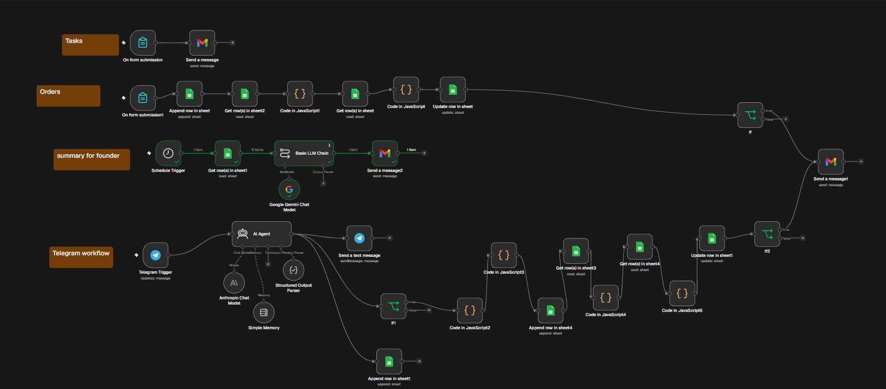

# AI-Powered Restaurant Operations System (n8n)

An end-to-end automated restaurant management system built with **n8n**. This project seamlessly integrates customer service, order processing, inventory management, and founder reporting using Agentic AI and deterministic workflows.

## System Architecture & Live Demo

### Workflow Overview

### Live Demo
https://github.com/abdelwahab798/n8n-Restaurant-AI-Automation-System/raw/refs/heads/main/assets/Video.mp4
## Key Features

- **Bilingual AI Telegram Order Agent (Arabic & English):** A smart conversational agent capable of understanding and responding to customer orders naturally in both Arabic and English, parsing requests into structured JSON, and calculating order totals.
- **Omnichannel Order Ingestion:** Captures and unifies orders coming from both the Telegram AI Bot and Web Forms into a centralized database.
- **Real-Time Inventory Management:** Automatically deducts required ingredients from the Google Sheets inventory the moment an order is confirmed.
- **Proactive Low-Stock Alerts:** Aggregates low-stock items and sends a single consolidated email notification to the management team whenever ingredients drop below their predefined reorder threshold.
- **Automated Daily Summaries:** Aggregates daily sales and item performance, sending a comprehensive summary report to the founder via email.
- **Strict State Management:** Ensures orders are only processed and deducted from inventory when the AI Agent confirmation status shifts strictly to `true` (confirmed).

## Architecture & Tech Stack

- **Workflow Engine:** n8n
- **Database & CRM:** Google Sheets
- **AI/LLM Provider:** Anthropic / Google Gemini (via n8n AI Agent)
- **Communication Channels:** Telegram API, Gmail API

## Repository Structure

- `workflow.json`: The complete exported n8n workflow file containing all integrated automation flows (Task Assignment, Web Form Orders, Telegram AI Agent, Inventory Deduction, Low-Stock Alerts, and Daily Founder Summary).
- `assets/`: Screenshots of the n8n workflow canvas and Google Sheets database schemas.

## Google Sheets Database Template

You can view and copy the exact Google Sheets schemas (including the pre-configured `ARRAYFORMULA` equations for auto-incrementing Order IDs and price calculations) using the links below:
- **[Sales Sheets Template Link](https://docs.google.com/spreadsheets/d/1SonEGn18FlERTnsUj4q8v2J2mQb05vwUOBzsYrklQbU/edit?usp=sharing)**
- **[Inventory Sheets Template Link](https://docs.google.com/spreadsheets/d/1GPg8y_Sre3tfV8ENy1tHZjkn7FuH7UEZjfD8t156MPM/edit?usp=sharing)**
- **[Telegram Sheets Template Link](https://docs.google.com/spreadsheets/d/1HCSQtziCt6_E2zTRx2lbAQ76k01kTXOni0j2GO0JMas/edit?usp=sharing)**

*(Go to `File` -> `Make a copy` on each spreadsheet to use them with your own n8n instance)*

## How to Setup and Run

1. **Download the Workflow:** Download the `workflow.json` file from this repository.
2. **Import to n8n:** Open your n8n instance, create a new workflow, click on the top-right menu (`...`) -> **Import from File**, and select `workflow.json`.
3. **Set Up Google Sheets:**
   - Open the three template links provided above and click **File -> Make a copy** to save each spreadsheet to your Google Drive.
   - Ensure all tabs (`Inventory`, `Components`, `Orders`, `Summary`, and `Chat History`) remain intact.
   - Re-map the Google Sheets nodes in n8n to point to your newly copied spreadsheets.
4. **Configure Credentials:**
   - Add your **Telegram Bot Token**.
   - Authenticate your **Gmail** account for alerts and daily reports.
   - Add your **LLM API Key** (Anthropic / Google Gemini) inside the AI Agent node.
5. **Activate:** Toggle the workflow to **Active** and test it via Telegram (in Arabic or English) or through the Order Form.

## Business Value

This system replaces manual order taking, eliminates human error in inventory tracking, prevents stockouts through proactive alerts, and provides automated business intelligence for restaurant owners.
